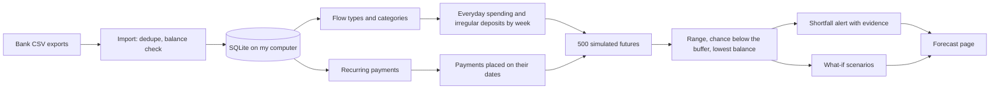

# Lookahead

Lookahead is a local-first cashflow forecaster for one chequing account. It reads the CSV exports
from my bank, works out which payments repeat, and simulates 500 possible next 30 days from my own
past weeks. From those futures it shows a likely range for the balance, the chance of dropping
below a safety buffer I choose, and a warning with the evidence behind it. Everything runs on my
own computer.

> Estimates for personal budgeting. Not financial advice.

## The central interaction

I open the Forecast page and read one sentence: "On track" or "Possible shortfall: 34% chance
your balance dips below your $200 buffer around Oct 8". Under it are the numbers behind it (the
lowest expected balance, the chance of going below the buffer and below $0), a chart of the range,
and the payments and assumptions that drive the low point. Then I try a change ("spend $70 a week
less", "this deposit arrives a week late") and see how the chance moves before I decide anything.

## Features

- Import of bank CSV exports with duplicate detection and a balance check against the bank's own
  running balance.
- Categories for every transaction: rules for the clear cases, a small trained model for the rest,
  uncertain ones flagged for an optional check.
- Recurring payments found automatically (weekly, every two weeks, twice a month, monthly, yearly,
  and rent sent by hand), which I can confirm, edit or add.
- A 30-day forecast: recurring payments on their dates, everyday spending and irregular deposits
  drawn week by week from my own recent history, 500 simulated futures, a 10th-90th percentile band.
- A shortfall alert with its evidence, grouped into episodes so it does not repeat itself, and
  dismissable.
- What-if scenarios on the same futures, so the difference is the change and not luck.
- Planned items: money in or out I know is coming.
- A Time machine page that replays any past date of a synthetic persona with only the data known
  then.
- A Model report page with the test results, each with its n.

## How it works



Big one-time rows (a tuition payment, a large transfer) are kept out of the weekly draw and listed
on the page instead, so one event is not repeated every week.

## Run it

Python 3.13. On Windows:

```powershell
py -3.13 -m venv .venv
.venv\Scripts\activate
pip install -r requirements.txt
pytest -m "not slow"
streamlit run app/Home.py
```

The app opens on a synthetic demo account. To use my own data I put the exports in
`data/private/raw` and import them:

```powershell
python -m lookahead.ingest data/private/raw --db data/private/db/lookahead.db
```

The Time machine page needs its snapshots once (synthetic personas only, a few minutes):

```powershell
python -m lookahead.timemachine_snapshots
```

After changing the code, I restart the app: Streamlit reloads a page but keeps modules it has
already loaded.

## How it is evaluated

- **Rolling-origin backtest.** The forecast is replayed every Monday of a year (40 origins per
  persona). At each origin it may use only the rows posted by that day, and it is compared with
  the 30 days that followed: balance error at 7, 14 and 30 days against "the balance stays the
  same", the lowest balance, band coverage, the Brier score of the shortfall chance, and alerts
  (caught dips, false alerts per 30 days, lead time).
- **Rule zero.** A forecast uses only what was known at its origin. Tests rewrite or delete every
  later row and check that the forecast does not change.
- **Synthetic personas with a held-out set.** 30 generated personas from 8 kinds (students with
  family money, students at home or renting, salaried people, a tight budget, a freelancer). 20 are
  for development; every setting is chosen on those. 10 are held out for one final test. The
  persona mix was frozen before the first backtest.
- **My own account** is a separate column, never pooled with synthetic results. It is one
  person's history: a case study.

Every method and every change of plan is written down, before the run, in
[DECISIONS.md](DECISIONS.md).

## Results

### Transaction categorizer (my own account, holdout scored once)

| Test set | n | Accuracy | Macro-F1 |
|---|---|---|---|
| Test A: later rows, mostly merchants seen before | 114 rows, 35 merchants | 91.2% | 69.6% |
| Test B: merchants never seen in any training data | 48 rows, 26 merchants | 72.9% | 49.8% |

Trained on 447 labelled rows from 82 merchants plus synthetic rows. Test B has 107 rows in total;
59 of them come from one chain that is also in my synthetic training data, so I leave them out of
the number above. Most categories have fewer than 10 test rows.

### Forecast and alerts (final test)

TO FILL AFTER FINAL TEST. The held-out personas have not been run. Development numbers are on
the Model report page and in `docs/results/`; they are not final.

| | Synthetic, held out (10 personas) | My account |
|---|---|---|
| Error at 7 / 14 / 30 days, against "balance stays" | TO FILL AFTER FINAL TEST | TO FILL AFTER FINAL TEST |
| 80% band coverage | TO FILL AFTER FINAL TEST | TO FILL AFTER FINAL TEST |
| Lowest balance bias | TO FILL AFTER FINAL TEST | TO FILL AFTER FINAL TEST |
| Brier score of the shortfall chance | TO FILL AFTER FINAL TEST | TO FILL AFTER FINAL TEST |
| Alerts: caught / precision / false per 30 days | TO FILL AFTER FINAL TEST | TO FILL AFTER FINAL TEST |

## Limitations

- The forecast does not expect tuition or other large one-time payments. Large deposits that keep
  arriving (an allowance, family transfers: at least two earlier ones of similar size) are
  forecast as random arrivals at their own rate and sizes; a first or one-off large deposit is
  not expected. For students paid in lump sums the error is still in the thousands of dollars.
- On synthetic data the forecast is too optimistic; on my own account it is too pessimistic. The
  80% band is too narrow in both.
- The alert rule is provisional until the final test.
- Only one chequing account. Credit cards and other accounts are not modelled.
- The synthetic personas follow rules I wrote, and the real results are one person.
- Bank fees are a recent average, not a model of when they happen.

## Privacy

- Everything runs locally. The database, my exports and anything derived from them stay in
  `data/private/`, which git ignores.
- Text that leaves that folder (a screenshot, a report) is pseudonymized first: people's names and
  reference numbers become keyed tokens.
- The import, the backtest and the report commands print counts and summary numbers, never rows.
- Nothing is sent anywhere unless I turn on an optional feature that is off by default (described
  in DECISIONS.md).

Estimates for personal budgeting. Not financial advice.
