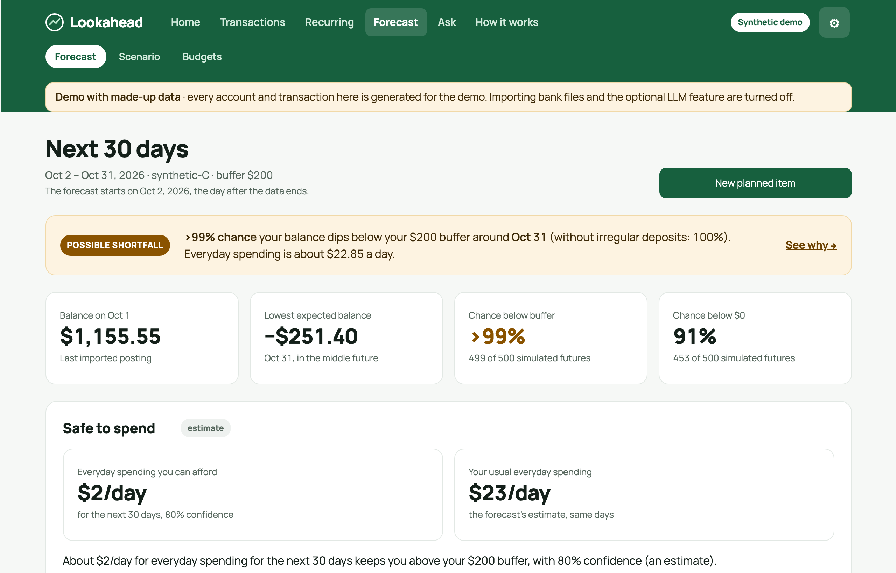
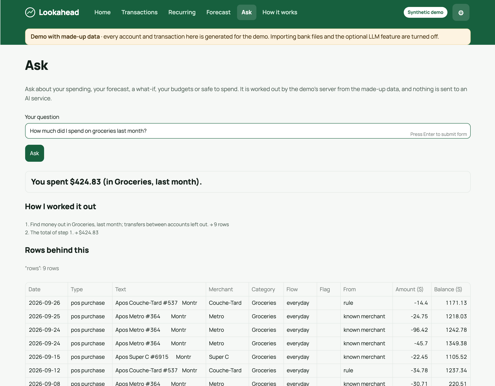
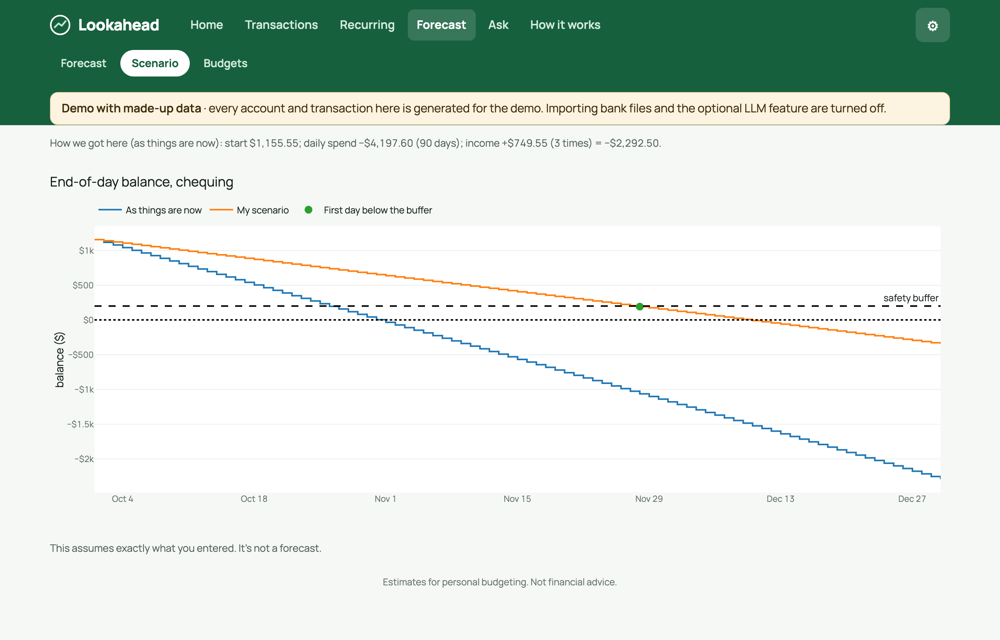
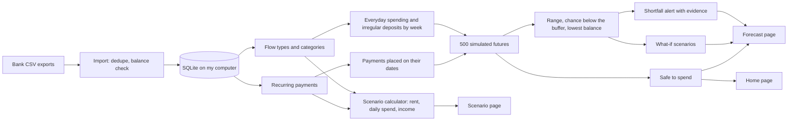

# Lookahead

Lookahead is an app I built to forecast the balance of one chequing account for the next 30
days. It reads bank CSV exports, sorts every transaction into a category, works out which payments
repeat, and simulates 500 possible futures from the account's own past weeks. From those it shows
a likely range for the balance, the chance of dipping below a buffer you choose, and a warning with
the evidence behind it. It also has a "safe to spend" figure and what-if scenarios. Everything runs
on your own computer.

It is a personal project and a study in testing a model honestly. It is not financial advice.

## What it looks like

Try the demo: https://lookahead.streamlit.app (made-up accounts only; it may take a minute to
wake up if nobody has opened it for a while).

These pictures come from the demo, which runs on made-up accounts only.



**Forecast.** A warning before the balance may dip below the buffer: the chance, the day it is
most likely, and how many of the 500 simulated futures go below. "See why" opens the evidence.



**Ask.** A question in plain words, answered by code from the stored rows, with every step and the
rows behind the number. No AI service is used for it.



**Scenario.** What if everyday spending dropped to $25 a day? The blue line is things as they are
now, the orange line is the scenario, and the dot is the first day below the buffer.

## Categorizer results

I labelled my own transactions by hand (17 categories) and fixed two test sets before tuning
anything. Each was scored once, and nothing was changed after.

| Test set | n | Accuracy |
|---|---|---|
| Later rows, mostly merchants seen in training | 114 rows (35 merchants) | 91.2% |
| The same, rows the model was confident about (not flagged for review) | 104 rows | 98.1% |
| Merchants never seen in training | 48 rows (26 merchants) | 72.9% |
| The same, rows the model was confident about | 18 rows | 94.4% |
| Never-seen merchants, with the opt-in LLM fallback | 48 rows (26 merchants) | 83.3% |

The never-seen merchants are the honest number for a new account. When the model is unsure it
flags the row for review instead of guessing, and the confident rows are right 94 to 98% of the
time. The LLM fallback is off by default; when I turn it on, only the merchant name of a card
purchase is sent, never an amount, a date or a person's name. The test sets are small: most
categories have fewer than 10 test rows, and macro-F1 is much lower (69.6% on the 114 rows,
49.8% on the 48).

### Smarter categories for new merchants (RAG)

When the model is unsure about a merchant it has never seen, it can ask Haiku 4.5 for the
category. Haiku is shown only similar merchants I have already labelled and the closest entries
from a public list of chains, and its answer must cite one of them. It is off by default; only
merchant names (mine and public chains) and category labels are sent.

I tested it on a public synthetic benchmark,
[DoDataThings "US Bank Transaction Categories v2"](https://huggingface.co/datasets/DoDataThings/us-bank-transaction-categories-v2)
(MIT), split by merchant so that test merchants are not in training. The adopt rule was
committed before scoring. A check afterwards found that the split is not perfect: 63 of the 275
test merchants have a near-identical name in training ("DR. SMITH DERMATOLOGY" and "SMITH
DERMATOLOGY"). My categorizer alone already got 90 of those 91 rows right, so at most one row of
the gain can come from them.

| Unseen merchants, public benchmark | n | Accuracy |
|---|---|---|
| My categorizer alone | 600 rows (275 merchants) | 75.8% |
| With RAG | 600 rows (275 merchants) | 86.3% |

On my own account it then passed a no-harm check: it was no worse on 18 rows of new merchants
and 60 rows of known ones (allowed: at most 2 and 1 rows worse). That is too few rows to measure a
gain on my data. It took three attempts to get one valid run: in the first, a bug refused every
answer, and the second was void by its own rule. The answer parser was fixed between runs, without
looking at any labels. All of it is recorded in [DECISIONS.md](DECISIONS.md).

Rejected: training the model on cleaned merchant names and letting a list of Canadian chains
answer rows directly. On the same dataset, an earlier split, it scored 74.3% against 75.2% without
it (600 rows, 356 merchants), so it stays off.

## Ask results

The Ask page answers questions about the account ("how much did I spend on groceries last
month?"). An offline parser turns the question into a plan of building blocks; Lookahead checks
the plan and computes the answer itself. I also built an optional LLM planner (Claude Haiku 4.5):
it writes only the plan and never sees a number; it is sent the question and fixed instructions,
nothing from the account. It
would be offered as "Smarter questions" only if it passed a rule I committed before the test.

It failed, so Ask ships offline-only. The test set has 100 questions (76 answerable, 14 that
should be refused, 10 ambiguous) on synthetic accounts, written by two separate AI agents that
never saw my prompt or development questions (their instructions share one convention with it:
the largest purchase is the maximum over rows). The answer keys are model-written too. Scored
once.

| Test set, 100 questions | LLM planner | Offline parser |
|---|---|---|
| Correct on answerable (rule: 85% or more) | 93.4% (71 of 76) | 43.4% (33 of 76) |
| Refused, of should-refuse (rule: 90% or more) | 92.9% (13 of 14) | 85.7% (12 of 14) |
| Wrong answer shown as if right, of all (rule: 5% or less) | **8.0% (8 of 100)** | 10.0% (10 of 100) |
| Ambiguous, handled like the answer key | 8 of 10 | 2 of 10 |

The LLM met every condition but one: it showed 8 wrong answers as if they were right, and the cap
was 5. What I have to disclose:

- The offline parser, which ships, was wrong without saying so more often (10 of 100). The cap
  applied only to the LLM. I keep the rule as written, because changing it after seeing the result
  would make the test worthless; an Ask v2 needs a fixed rule and a new test set.
- The offline parser was fitted to my development questions: 76% there (114 of 150), 43.4% on
  the test set (33 of 76).
- On the development questions the LLM scored 98% (147 of 150). I flagged that as too good, since
  its instructions were written from its own misses on those questions. The test set measured
  93.4% (71 of 76).

All runs, including the void ones, are in [DECISIONS.md](DECISIONS.md) and
`docs/results/ask_ledger.jsonl`.

## How I evaluate

- **Rules written first.** Before each experiment I write down what I will measure and the rule
  for adopting the change, in [DECISIONS.md](DECISIONS.md), commit it, and only then run it. A
  change that does not pass its rule is not adopted, and every variant I try is counted. So far
  eight ideas for the forecaster lost and none was adopted: calibrating the range and the dip
  chance, an income prototype of random lump arrivals, a LightGBM model of everyday spending
  (worse than the simple weekday average at every horizon), forecasting lump income and repeated
  large payments, a "renewal draw" for when the next deposit arrives, anchoring the forecast to
  recent net flow, blending it with "the balance stays the same", and prefilled "Looks right"
  proposals for recurring payments.
- **Synthetic personas.** I generate accounts from rules I wrote, in 8 kinds: students living at
  home, students renting, international students with steady or stretched family money, people
  paid every two weeks or twice a month, workers on a tight budget, a freelancer. 20 are for
  development, and every setting is chosen on those. 10 are held out for one final test.
- **Rolling-origin backtest.** The forecast is replayed at 40 weekly origins (Mondays). At each
  one it may use only the rows posted by then, and it is scored against the 30 days that followed.
  Tests rewrite or delete later rows and check that the forecast does not change.
- **Berka.** As an outside check I use the public PKDD'99 Berka bank data (a Czech bank in the
  1990s), split into development and held-out accounts. Source: the PKDD'99 Discovery Challenge
  financial dataset, prepared by Petr Berka and Marta Sochorova. The data is not included here (only
  the account-id split lists in `docs/`); download it yourself.
- **The held-out test ran once (2026-11-19).** The forecaster was final, and the rules for the test
  were committed before anything held out was opened
  ([protocol](docs/specs/2026-11-19-held-out-test-protocol.md)). One command first reran the
  development data and had to reproduce the development report exactly. Only then did it score the
  10 held-out personas of each synthetic set and the 200 held-out Berka accounts of each pool. Every
  attempt goes in a tracked ledger, and a second run is refused. Nothing was tuned after it.
  Two things happened before the run, and both are disclosed in [DECISIONS.md](DECISIONS.md)
  (2026-11-20). Two old tests had forecast one held-out persona, without printing or comparing any
  outcome. And while I built the generator (2026-10-08 and 2026-10-09), I looked at the generated
  balances of the 12-month held-out personas; one of them was among the reasons for the last
  generator change. No forecaster setting or threshold was chosen on them.
- **My own account is never scored in public.** I use it to find problems, but no forecast
  error, balance or amount from it is in this repository.

## Forecaster results

**Development next to held-out.** The final forecaster at 40 weekly origins per persona or account,
500 futures, alert threshold 35%. Scores use scored origins: those not already below the line,
with at least 20 past 30-day windows for the random walk. The numbers are pooled over those origins
([docs/results/held_out_2026-11-20.md](docs/results/held_out_2026-11-20.md), where the per-kind and
per-account averages are too).

| | Synthetic 12 months: development | held-out | Synthetic 24 months: development | held-out | Berka: development | held-out |
|---|---|---|---|---|---|---|
| Scored origins (personas or accounts) | 726 (20) | 320 (10) | 717 (20) | 329 (10) | 7,135 (200) | 7,159 (200) |
| CRPS skill vs "balance stays", mean of 30 days | +28.3% | +26.4% | +33.6% | +27.9% | +27.8% | +27.6% |
| same, averaged per archetype / per account | +40.8% (8) | +46.9% (8) | +47.8% (8) | +46.6% (8) | +30.0% (200) | +31.6% (200) |
| CRPS skill vs random walk, mean of 30 days | +10.0% | +9.1% | +9.2% | +3.4% | +3.0% | +2.4% |
| CRPS skill vs random walk, day 30 | −4.2% | +1.7% | −11.4% | −10.1% | −20.5% | −23.0% |
| 80% band coverage, all 30 days | 58.9% | 61.8% | 63.1% | 64.0% | 57.0% | 58.3% |
| Brier skill of the dip chance vs random walk | +23.0% | +8.6% | +43.0% | −4.3% | −5.9% | −7.3% |
| Lowest-balance bias, mean (positive = too optimistic) | +708 | +1,176 | +625 | +1,034 | +136 | +96 |
| Dips caught, *alert on* in the 30 days before | 47/52 | 34/42 | 45/51 | 17/24 | 238/283 | 265/301 |
| Dips caught, *alert opened* before the dip | 25/52 | 21/42 | 16/51 | 8/24 | 174/283 | 193/301 |
| Alert precision | 76% (22/29) | 62% (13/21) | 68% (15/22) | 78% (7/9) | 34% (199/579) | 36% (227/627) |
| False alerts per 30 days | 0.041 | 0.107 | 0.042 | 0.026 | 0.228 | 0.239 |
| Random walk at 35%: *alert on* / *alert opened* | 48/52 / 13/52 | 37/42 / 13/42 | 44/51 / 12/51 | 16/24 / 1/24 | 217/283 / 123/283 | 252/301 / 139/301 |

Pooled numbers weigh origins with larger balances more; the per-archetype / per-account row gives
each archetype (synthetic) or account (Berka) equal weight, with the number of units in brackets.
*Alert on*: an alert was on at some point in the 30 days before the dip (this includes alerts that
opened when the balance was already below the line). *Alert opened*: an alert opened at an ordinary
origin before the dip. Berka's line is "fell below one month's outflow". Its amounts are in scaled
units (the bias row too), so only skills, coverage, Brier and dips compare across datasets. The
synthetic held-out pools are small (10 personas, 24 and 42 dip episodes), and neighbouring weekly
origins share outcomes, so their effective n is smaller than shown. The Berka sensitivity pool (200
more accounts, a looser filter) is reported apart in the result file and decides nothing.

The rest of this section is development data only.

**Synthetic personas.** CRPS skill over 30 days against two simple forecasts (higher is better;
0 means no better than that forecast, below 0 worse). "Balance stays" keeps today's balance. The
random walk adds today's balance to the 30-day changes of past windows from the year before the
origin. Mean over the 8 kinds of persona, equal weight, 20 development personas, 40 weekly
origins each, 500 futures per origin
([docs/results/baselines_2026-10-17.md](docs/results/baselines_2026-10-17.md)):

| Synthetic set | Origins scored | Skill vs "balance stays" | Skill vs random walk |
|---|---|---|---|
| 12 months of history | 726 | +40.8% | +24.8% |
| 24 months of history | 717 | +47.8% | +29.4% |

The gain is uneven. Against the random walk, three kinds are worse on the 12-month set and two on
the 24-month set. By kind of persona (origins, personas):

| Kind of persona | 12 months: vs stays / vs walk | 24 months: vs stays / vs walk |
|---|---|---|
| SAL, salaried, paid every two weeks | +86.3% / +67.4% (120, 3) | +90.8% / +77.3% (120, 3) |
| TIGHT, worker on a tight budget | +74.8% / +63.8% (98, 3) | +81.4% / +71.9% (86, 3) |
| SEM, salaried, paid twice a month | +70.0% / +58.3% (40, 1) | +78.9% / +71.3% (40, 1) |
| DHOME, student living at home | +32.0% / +11.7% (120, 3) | +37.9% / +12.5% (120, 3) |
| IFAM, international student, steady family money | +24.4% / +6.4% (120, 3) | +31.9% / +8.7% (120, 3) |
| FREE, freelancer, irregular deposits | +19.8% / -3.3% (40, 1) | +35.7% / +8.5% (30, 1) |
| DRENT, student renting and working | +16.4% / -3.3% (102, 3) | +21.8% / -3.3% (120, 3) |
| ITIGHT, international student, stretched family money | +3.0% / -3.0% (86, 3) | +4.3% / -11.4% (81, 3) |

These numbers were computed before I renamed five made-up shop names in the generator
(2026-11-17). On the 12-month set I checked the effect: 794 of 800 origins are identical and the
other 6 changed slightly, and safe to spend (below) is identical everywhere. The 24-month set was
not checked at the time. I reran the baselines on the renamed code on 2026-11-19, before the
held-out test: 794 of 800 12-month origins and 799 of 800 24-month origins came out identical.

**Berka.** So far only a check that the forecaster runs and looks sane: on 400 development
accounts (200 primary, 200 for sensitivity) and 40 origins each, a forecast came back at all 16,000
origins ([docs/results/berka_sanity_2026-10-17.md](docs/results/berka_sanity_2026-10-17.md)).
The check flags one problem: the everyday-spending estimate is zero at 512 of 8,000 primary
origins (6.4%, in 83 of 200 accounts) and 1,178 of 8,000 sensitivity origins (14.7%, in 130 of
200 accounts), above the 5% the check allows. In the primary group most of them (464 of 512) are
origins where every payment out belongs to a recurring series. Development scores, next to
the synthetic sets: [docs/results/scores_development_2026-11-19.md](docs/results/scores_development_2026-11-19.md).

**Safe to spend.** The largest everyday spending a day that keeps 80% of the futures above the
buffer until the next expected income. On the 20 development personas (800 origins,
[docs/results/safe_to_spend_check_2026-11-17.md](docs/results/safe_to_spend_check_2026-11-17.md)),
where the amount was tight (at most 2 times the usual spending) and the actual spending stayed at
or below it, 89% of the origins stayed above the buffer (31 of 35 origins, 10 personas). By the
rule I wrote before running it, the 80% holds near the edge. 35 origins is a small n, so this says
the amount is not clearly optimistic, not that it is calibrated.

**Alerts.** The app alerts when more than 35% of the futures dip below the buffer. I chose 35%
on the 20 development personas of the 12-month set (52 shortfall episodes, leave one persona out;
[docs/results/thresholds_raw_2026-11-19.md](docs/results/thresholds_raw_2026-11-19.md)). Caught,
counted two ways: an alert was on in the 30 days before 47 of 52 dips, and an alert opened before
the dip for 25 of 52 (the first count includes alerts that opened when the balance was already
below the buffer). Precision 73% (22 of 30 alerts), 0.047 false alerts per 30 days, with the
threshold chosen on the other personas each time (leave one persona out). With 35% fixed on all 20
personas, which is what the development column of the table above shows: precision 76% (22 of 29),
0.041 false alerts per 30 days. 52 episodes from 8 personas is a small n.

## How it works



Big one-time rows (a tuition payment, a large transfer) are kept out of the weekly draw and listed
on the page instead, so one event is not repeated every week. Big rows that keep coming back at a
similar size (deposits, and payments seen 6 or more times a year) are drawn as random arrivals
instead. The Scenario page is a simpler calculator, not the simulation: it adds up rent, everyday
spending and income day by day to an end date, prefilled from the history, to try out a plan.

## Run it on the demo data

The demo uses made-up accounts from my generator. No bank data and no keys are needed. It needs
Python 3.13 (on macOS, for example `brew install python@3.13`).

On macOS or Linux:

```bash
python3.13 -m venv .venv
source .venv/bin/activate
pip install -r requirements.txt
LOOKAHEAD_DEMO=1 streamlit run app/Home.py
```

On Windows (PowerShell):

```powershell
py -3.13 -m venv .venv
.venv\Scripts\activate
pip install -r requirements.txt
$env:LOOKAHEAD_DEMO = "1"
streamlit run app/Home.py
```

`LOOKAHEAD_DEMO=1` turns on demo mode: synthetic accounts only, no CSV import, no outside calls,
and code that refuses to open anything under `data/private`. The Time Machine page replays past
dates of the synthetic accounts from snapshots kept in `data/demo/timemachine`.

To check the code: `pip install -r requirements-dev.txt`, then `pytest`. The full run takes a few
minutes; `pytest -m "not slow"` is the quick one.

Without demo mode the app only runs when served on localhost (`--server.address localhost`), so
that an account never ends up on a network by accident.

## Limits

- The synthetic personas follow rules I wrote, so they test the method on the kinds of accounts I
  thought of, not on the real world. Berka is the only outside data for the forecaster, and it is
  old and Czech.
- The forecast does not expect a first or one-off large payment (tuition, say). For students paid
  in lumps the error is still large.
- The 80% band is too narrow, and the dip chance is overconfident at the low end.
- One chequing account at a time. Credit cards and other accounts are not modelled.
- The categorizer numbers rest on small test sets labelled by one person.
- The held-out test ran once. Its synthetic pools are small (10 personas each), so their numbers
  move a lot with a few dips.
- On Berka the shortfall alert is noisy at 35%: precision 36% (227 of 627) and 0.24 false alerts
  per 30 days, well below the bar the threshold was picked for on synthetic data.
- The forecast is too optimistic about the lowest balance, more so on held-out synthetic personas.

Estimates for personal budgeting. Not financial advice.
