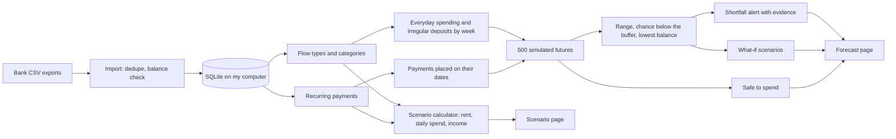

# Lookahead

Lookahead is an app I built to forecast the balance of one chequing account for the next 30
days. It reads bank CSV exports, sorts every transaction into a category, works out which payments
repeat, and simulates 500 possible futures from the account's own past weeks. From those it shows
a likely range for the balance, the chance of dipping below a buffer you choose, and a warning with
the evidence behind it. It also has a "safe to spend" figure and what-if scenarios. Everything runs
on your own computer.

It is a personal project and a study in testing a model honestly. It is not financial advice.

## Categorizer results

I labelled my own transactions by hand (17 categories) and fixed two test sets before tuning
anything. Each was scored once, and nothing was changed after.

| Test set | n | Accuracy |
|---|---|---|
| Later rows, mostly merchants seen in training | 114 rows (35 merchants) | 91.2% |
| The same, rows the model was confident about (not flagged for review) | 104 rows | 98.1% |
| Merchants never seen in training | 48 rows (26 merchants) | 72.9% |
| The same, rows the model was confident about | 18 rows | 94.4% |
| Never-seen merchants, with the opt-in LLM fallback | 48 rows (26 merchants) | 83.3% |

The never-seen merchants are the honest number for a new account. When the model is unsure it
flags the row for review instead of guessing, and the confident rows are right 94 to 98% of the
time. The LLM fallback is off by default; when I turn it on, only the merchant name of a card
purchase is sent, never an amount, a date or a person's name. The test sets are small: most
categories have fewer than 10 test rows, and macro-F1 is much lower (69.6% on the 114 rows,
49.8% on the 48).

## How I evaluate

- **Rules written first.** Before each experiment I write down what I will measure and the rule
  for adopting the change, in [DECISIONS.md](DECISIONS.md), commit it, and only then run it. A
  change that does not pass its rule is not adopted, and every variant I try is counted. So far
  eight ideas for the forecaster lost and none was adopted: calibrating the range and the dip
  chance, an income prototype of random lump arrivals, a LightGBM model of everyday spending
  (worse than the simple weekday average at every horizon), forecasting lump income and repeated
  large payments, a "renewal draw" for when the next deposit arrives, anchoring the forecast to
  recent net flow, blending it with "the balance stays the same", and prefilled "Looks right"
  proposals for recurring payments.
- **Synthetic personas.** I generate accounts from rules I wrote, in 8 kinds: students living at
  home, students renting, international students with steady or stretched family money, people
  paid every two weeks or twice a month, workers on a tight budget, a freelancer. 20 are for
  development, and every setting is chosen on those. 10 are held out for one final test.
- **Rolling-origin backtest.** The forecast is replayed at 40 weekly origins (Mondays). At each
  one it may use only the rows posted by then, and it is scored against the 30 days that followed.
  Tests rewrite or delete later rows and check that the forecast does not change.
- **Berka.** As an outside check I use the public PKDD'99 Berka bank data (a Czech bank in the
  1990s), split into development and held-out accounts. It is not committed here.
- **The held-out test has not been run.** I made this repository public before the forecaster's
  final held-out test. The held-out personas and Berka accounts are unopened, and every forecaster
  number below is on development data only. The test runs once, when the forecaster is final, and
  nothing is tuned after it.
- **My own account is never scored in public.** I use it to find problems, but no forecast
  error, balance or amount from it is in this repository.

## Forecaster results (development data only)

**Synthetic personas.** CRPS skill over 30 days against two simple forecasts (higher is better;
0 means no better than that forecast, below 0 worse). "Balance stays" keeps today's balance. The
random walk adds today's balance to the 30-day changes of past windows from the year before the
origin. Mean over the 8 kinds of persona, equal weight, 20 development personas, 40 weekly
origins each, 500 futures per origin
([docs/results/baselines_2026-10-17.md](docs/results/baselines_2026-10-17.md)):

| Synthetic set | Origins scored | Skill vs "balance stays" | Skill vs random walk |
|---|---|---|---|
| 12 months of history | 726 | +40.8% | +24.8% |
| 24 months of history | 717 | +47.8% | +29.4% |

The gain is uneven. Against the random walk, three kinds are worse on the 12-month set and two on
the 24-month set. By kind of persona (origins, personas):

| Kind of persona | 12 months: vs stays / vs walk | 24 months: vs stays / vs walk |
|---|---|---|
| SAL, salaried, paid every two weeks | +86.3% / +67.4% (120, 3) | +90.8% / +77.3% (120, 3) |
| TIGHT, worker on a tight budget | +74.8% / +63.8% (98, 3) | +81.4% / +71.9% (86, 3) |
| SEM, salaried, paid twice a month | +70.0% / +58.3% (40, 1) | +78.9% / +71.3% (40, 1) |
| DHOME, student living at home | +32.0% / +11.7% (120, 3) | +37.9% / +12.5% (120, 3) |
| IFAM, international student, steady family money | +24.4% / +6.4% (120, 3) | +31.9% / +8.7% (120, 3) |
| FREE, freelancer, irregular deposits | +19.8% / -3.3% (40, 1) | +35.7% / +8.5% (30, 1) |
| DRENT, student renting and working | +16.4% / -3.3% (102, 3) | +21.8% / -3.3% (120, 3) |
| ITIGHT, international student, stretched family money | +3.0% / -3.0% (86, 3) | +4.3% / -11.4% (81, 3) |

These numbers were computed before I renamed five made-up shop names in the generator
(2026-11-17). On the 12-month set I checked the effect: 794 of 800 origins are identical and the
other 6 changed slightly, and safe to spend (below) is identical everywhere. The 24-month set was
not checked. I rerun the baselines on the renamed code before the held-out test.

**Berka.** So far only a check that the forecaster runs and looks sane: on 400 development
accounts (200 primary, 200 for sensitivity) and 40 origins each, a forecast came back at all 16,000
origins ([docs/results/berka_sanity_2026-10-17.md](docs/results/berka_sanity_2026-10-17.md)).
The check flags one problem: the everyday-spending estimate is zero at 512 of 8,000 primary
origins (6.4%, in 83 of 200 accounts) and 1,178 of 8,000 sensitivity origins (14.7%, in 130 of
200 accounts), above the 5% the check allows. In the primary group most of them (464 of 512) are
origins where every payment out belongs to a recurring series. No accuracy on Berka has been
scored yet.

**Safe to spend.** The largest everyday spending a day that keeps 80% of the futures above the
buffer until the next expected income. On the 20 development personas (800 origins,
[docs/results/safe_to_spend_check_2026-11-17.md](docs/results/safe_to_spend_check_2026-11-17.md)),
where the amount was tight (at most 2 times the usual spending) and the actual spending stayed at
or below it, 89% of the origins stayed above the buffer (31 of 35 origins, 10 personas). By the
rule I wrote before running it, the 80% holds near the edge. 35 origins is a small n, so this says
the amount is not clearly optimistic, not that it is calibrated.

Not reported yet: the alert numbers (shortfalls caught, precision, false alerts per 30 days). The
alert threshold is provisional until the final test.

## How it works



Big one-time rows (a tuition payment, a large transfer) are kept out of the weekly draw and listed
on the page instead, so one event is not repeated every week. Big rows that keep coming back at a
similar size (deposits, and payments seen 6 or more times a year) are drawn as random arrivals
instead. The Scenario page is a simpler calculator, not the simulation: it adds up rent, everyday
spending and income day by day to an end date, prefilled from the history, to try out a plan.

## Run it on the demo data

The demo uses made-up accounts from my generator. No bank data and no keys are needed. It needs
Python 3.13 (on macOS, for example `brew install python@3.13`).

On macOS or Linux:

```bash
python3.13 -m venv .venv
source .venv/bin/activate
pip install -r requirements.txt
LOOKAHEAD_DEMO=1 streamlit run app/Home.py
```

On Windows (PowerShell):

```powershell
py -3.13 -m venv .venv
.venv\Scripts\activate
pip install -r requirements.txt
$env:LOOKAHEAD_DEMO = "1"
streamlit run app/Home.py
```

`LOOKAHEAD_DEMO=1` turns on demo mode: synthetic accounts only, no CSV import, no outside calls,
and code that refuses to open anything under `data/private`. The Time Machine page replays past
dates of the synthetic accounts from snapshots kept in `data/demo/timemachine`.

To check the code: `pip install -r requirements-dev.txt`, then `pytest`. The full run takes a few
minutes; `pytest -m "not slow"` is the quick one.

Without demo mode the app only runs when served on localhost (`--server.address localhost`), so
that an account never ends up on a network by accident.

## Limits

- The synthetic personas follow rules I wrote, so they test the method on the kinds of accounts I
  thought of, not on the real world. Berka is the only outside data, it is old and Czech, and it
  has not been scored yet.
- The forecast does not expect a first or one-off large payment (tuition, say). For students paid
  in lumps the error is still large.
- The 80% band is too narrow, and the dip chance is overconfident at the low end.
- One chequing account at a time. Credit cards and other accounts are not modelled.
- The categorizer numbers rest on small test sets labelled by one person.
- The held-out test has not been run, so none of the forecaster numbers are final.

Estimates for personal budgeting. Not financial advice.
